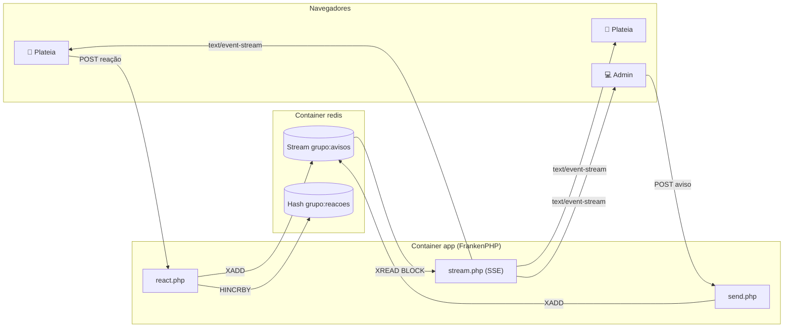

# 📢 Grupo de Avisos: Server-Sent Events com PHP

Demo da palestra **"Server Sent Events (SSE): Seu PHP já faz tempo real, você só não sabia"**, apresentada no **PHPeste** em São Luís-MA, por [Monica Craveiro](https://github.com/mocraveirodev).

É um "grupo de avisos do WhatsApp" em tempo real, feito só com PHP, Redis e o `EventSource` que todo navegador já tem.

- A **admin** manda avisos por um painel.
- A **plateia** entra pelo celular lendo um QR code e recebe os avisos na hora.
- Qualquer pessoa pode **reagir** com emojis, e o placar atualiza para todo mundo.
- Se a conexão cair, o navegador **reconecta sozinho e recupera o que perdeu** usando o `Last-Event-ID`.

Não usa framework, WebSocket nem build de front-end, e o JavaScript de reconexão é zero.

---

## Sumário

- [O que você precisa](#o-que-você-precisa)
- [Rodando em 3 comandos](#rodando-em-3-comandos)
- [Endereços](#endereços)
- [Testando sem navegador (curl)](#testando-sem-navegador-curl)
- [Abrindo no celular (mesma rede Wi-Fi)](#abrindo-no-celular-mesma-rede-wi-fi)
- [Abrindo para qualquer celular, de qualquer rede (túnel)](#abrindo-para-qualquer-celular-de-qualquer-rede-túnel)
- [Roteiro da demo em 3 atos](#roteiro-da-demo-em-3-atos)
- [Como funciona](#como-funciona)
- [As 7 armadilhas do SSE em PHP (e onde cada uma está no código)](#as-7-armadilhas-do-sse-em-php-e-onde-cada-uma-está-no-código)
- [Configuração (.env)](#configuração-env)
- [Endpoints](#endpoints)
- [Estrutura do projeto](#estrutura-do-projeto)
- [Rodando sem Docker](#rodando-sem-docker)
- [Colocando num servidor (para usar num evento)](#colocando-num-servidor-para-usar-num-evento)
- [Problemas comuns](#problemas-comuns)
- [Licença](#licença)

---

## O que você precisa

| Ferramenta | Versão | Como conferir |
|---|---|---|
| [Docker](https://docs.docker.com/get-docker/) | 20.10 ou mais nova | `docker --version` |
| Docker Compose v2 (já vem no Docker Desktop) | 2.20 ou mais nova | `docker compose version` |
| Git | qualquer | `git --version` |

Funciona em **Linux, macOS (Intel e Apple Silicon) e Windows** (com Docker Desktop + WSL 2).

> **Windows:** rode os comandos no terminal do WSL (Ubuntu) ou no PowerShell. Se clonar pelo Windows, deixe o Git manter as quebras de linha como estão (`git config --global core.autocrlf input`).

Você **não** precisa ter PHP, Redis nem Node instalados: tudo roda dentro dos containers.

---

## Rodando em 3 comandos

```bash
git clone https://github.com/mocraveirodev/sse-grupo-de-avisos.git
cd sse-grupo-de-avisos
docker compose up -d --build
```

Na primeira vez o Docker baixa as imagens (FrankenPHP e Redis) e instala a extensão do Redis. Isso leva de 1 a 3 minutos. Nas próximas, sobe em segundos.

Confira se está tudo de pé:

```bash
docker compose ps
```

Os dois serviços (`app` e `redis`) devem aparecer como `running`, e o `redis` também como `healthy`.

Agora abra **duas janelas** do navegador, lado a lado:

1. http://localhost:8080/admin.html: o painel da admin. O token padrão é `phpeste`.
2. http://localhost:8080/: a página da plateia.

Mande um aviso pelo painel e veja ele aparecer na outra janela na hora. 🎉

Para parar:

```bash
docker compose down        # para e remove os containers (os avisos ficam salvos no Redis)
docker compose down -v     # para e apaga tudo, inclusive os avisos e reações
```

> **Quer trocar a senha ou as portas?** Copie o arquivo de exemplo e edite: `cp .env.example .env`. Detalhes em [Configuração](#configuração-env). Sem `.env`, os valores padrão são usados.

---

## Endereços

| Página | Endereço | Para quê |
|---|---|---|
| Plateia | http://localhost:8080/ | Recebe os avisos e manda reações (feita para celular) |
| Painel da admin | http://localhost:8080/admin.html | Manda avisos, mostra o QR code, o placar e quantas pessoas estão online. É a tela para projetar |
| Versão com polling | http://localhost:8080/polling.html | O mesmo grupo, mas perguntando "já chegou?" a cada 2s. Serve para comparar |
| Stream SSE puro | http://localhost:8080/stream.php | O endpoint SSE em si |
| Armadilha do buffer | http://localhost:8080/armadilha-buffer.php | A armadilha 1 ao vivo (veja abaixo) |
| HTTPS (HTTP/2) | https://localhost:8443/ | Igual ao de cima, mas sem o limite de 6 conexões do HTTP/1.1 (o navegador vai avisar que o certificado é local; pode aceitar) |

---

## Testando sem navegador (curl)

Abra um terminal e deixe o stream rodando. O `-N` desliga o buffer do próprio curl:

```bash
curl -N http://localhost:8080/stream.php
```

Em **outro** terminal, mande um aviso:

```bash
curl -X POST http://localhost:8080/send.php \
     -H 'X-Admin-Token: phpeste' \
     --data-urlencode 'texto=Olá, PHPeste!'
```

No primeiro terminal aparece o protocolo SSE "cru". É só texto:

```text
retry: 2000

event: reacoes
data: {"👍":0,"😂":0,"🔥":0,"❤️":0,"🤯":0}

: ping

event: presenca
data: {"online":1}

id: 1792184533937-0
event: aviso
data: {"texto":"Olá, PHPeste!","autor":"Admin","em":"2026-10-16T18:02:13-03:00"}
```

- `id:` é o ID do evento. É ele que o navegador devolve no header `Last-Event-ID` quando reconecta.
- `event:` é o nome do evento, que o JavaScript escuta com `addEventListener('aviso', ...)`.
- `data:` é o conteúdo (aqui, JSON).
- `retry:` diz ao navegador quantos milissegundos esperar antes de reconectar.
- Linhas que começam com `:` são comentários: o heartbeat que mantém a conexão viva.

Para simular uma reconexão, peça os eventos a partir de um ID:

```bash
curl -N http://localhost:8080/stream.php -H 'Last-Event-ID: 1792184533937-0'
```

E reaja como se fosse alguém da plateia:

```bash
curl -X POST http://localhost:8080/react.php -H 'Content-Type: application/json' -d '{"emoji":"🔥"}'
```

---

## Abrindo no celular (mesma rede Wi-Fi)

`localhost` no celular é o próprio celular, então ele precisa do **IP da sua máquina na rede**.

1. Descubra o IP:
   - **macOS:** `ipconfig getifaddr en0`
   - **Linux:** `hostname -I | awk '{print $1}'`
   - **Windows (PowerShell):** `ipconfig` e procure "Endereço IPv4" do adaptador Wi-Fi
2. No painel da admin, coloque `http://SEU_IP:8080/` no campo **"Endereço que a plateia vai abrir"**. O QR code se atualiza sozinho.
3. Aponte a câmera do celular para o QR code.

Se o celular não abrir:

- Confira se o celular e o computador estão **na mesma rede** (redes de visitante costumam isolar os aparelhos).
- No **Windows**, libere a porta 8080 no firewall quando ele perguntar (ou em "Permitir um app pelo Firewall").
- No **macOS**, se o firewall estiver ligado, permita conexões de entrada para o Docker.

> Num evento de verdade, o Wi-Fi costuma bloquear conexões entre aparelhos. Para isso, use o [túnel](#abrindo-para-qualquer-celular-de-qualquer-rede-túnel) ou [coloque num servidor](#colocando-num-servidor-para-usar-num-evento).

> **Dica:** para não ter que digitar o IP toda vez, coloque `PUBLIC_URL=http://SEU_IP:8080/` no `.env` e rode `docker compose up -d`. O painel já abre com esse endereço no QR code.

---

## Abrindo para qualquer celular, de qualquer rede (túnel)

O jeito mais rápido de a plateia acessar a demo que está rodando **no seu notebook**, inclusive pelo 4G, é um túnel do Cloudflare. Ele não pede conta nem configuração e gera um endereço público `https://alguma-coisa.trycloudflare.com` que aponta para o seu app.

O túnel já está no `compose.yaml`, mas desligado por padrão. Para ligar:

```bash
docker compose --profile tunnel up -d
```

Abra o painel (http://localhost:8080/admin.html). Em alguns segundos, o campo do QR code se preenche sozinho com o endereço do túnel e aparece "✅ via túnel do Cloudflare". Aí é só a plateia escanear.

Se quiser ver o endereço no terminal:

```bash
docker compose logs tunnel | grep trycloudflare.com
```

Para desligar tudo (inclusive o túnel):

```bash
docker compose --profile tunnel down
```

Bom saber:

- **O endereço muda** cada vez que o túnel sobe. O painel sempre pega o novo, mas o QR code de um slide estático ficaria desatualizado. Projete o painel.
- Ele usa **HTTPS e HTTP/2**, então o limite de 6 conexões do HTTP/1.1 não atrapalha.
- Túnel sem conta é para teste: **não tem garantia de disponibilidade** e o Cloudflare limita a **200 requisições simultâneas**. Cada pessoa no grupo ocupa uma (a conexão SSE fica aberta), então dá para umas 150 pessoas com folga. Para mais que isso, [use um servidor](#colocando-num-servidor-para-usar-num-evento).
- O notebook continua sendo o servidor: ele precisa de **internet estável** durante a demo. O 4G do celular roteado costuma ser mais confiável que o Wi-Fi do evento.
- No Ato 3, opção B, o `docker compose stop app` derruba só o app. O túnel continua no ar com o mesmo endereço.

---

## Roteiro da demo em 3 atos

Roteiro pensado para uns 5 minutos de palco. Antes de subir, clique em **"Limpar grupo"** no painel.

### Ato 1: "Olha como é simples" (1 min)

Projete um terminal e rode:

```bash
curl -N http://localhost:8080/stream.php
```

Mande um aviso pelo painel e mostre o texto chegando. A mensagem é: *"é só HTTP que não fecha a conexão"*.

### Ato 2: A plateia entra no grupo (2–3 min)

1. Projete o **painel da admin** (o QR code e o contador de online ficam grandes no lado direito). Se a plateia não estiver na mesma rede que você, suba antes o [túnel](#abrindo-para-qualquer-celular-de-qualquer-rede-túnel).
2. Peça para a plateia escanear o QR code e acompanhe o contador subindo.
3. Mande avisos pelos atalhos (ou escreva os seus) e vá pedindo reações. Os emojis sobem na tela de todo mundo.
4. Destaque que **reagir é um `POST` comum, e o retorno chega pelo SSE**: SSE + POST dá conta de muita coisa para a qual se usaria WebSocket.

### Ato 3: O elevador (Last-Event-ID) (1 min)

Mostre que quem "sai do elevador" não perde a conversa. Escolha uma das opções:

**Opção A (recomendada): o botão do elevador**

1. No painel, clique em **"🛗 Derrubar todo mundo por 10s"**.
2. O servidor manda para cada navegador um novo `retry: 10000` e fecha a conexão. Os celulares mostram "🛗 volto em 10s".
3. Enquanto isso, mande dois ou três avisos pelo painel. Ninguém recebe nada ainda.
4. Depois de 10 segundos, cada navegador reconecta sozinho mandando o header `Last-Event-ID` e recebe exatamente os avisos que perdeu.

Para mostrar o header, deixe o DevTools aberto na aba **Network** de uma aba da plateia: a nova requisição para `stream.php` vai com `Last-Event-ID` nos *Request Headers*. Esse ato também mostra que o próprio servidor controla o tempo de reconexão pelo campo `retry:`.

**Opção B (mais dramática): derrubar o servidor de verdade**

```bash
docker compose stop app
docker compose run --rm app php bin/aviso.php "Enquanto o servidor estava fora 1"
docker compose run --rm app php bin/aviso.php "Enquanto o servidor estava fora 2"
docker compose start app
```

Os celulares mostram "reconectando…" e, quando o servidor volta, recebem os dois avisos que perderam. Funciona porque os avisos ficam no Redis, que continuou no ar. O `stop` leva uns 3 segundos, porque as conexões SSE não terminam sozinhas e o Docker precisa derrubá-las (é o `stop_grace_period` do `compose.yaml`).

### Bônus: comparação com polling

Abra http://localhost:8080/polling.html e a aba Network do DevTools. Ali o navegador pergunta "já chegou?" a cada 2 segundos e a tela conta quantas perguntas voltaram vazias. Na versão SSE a aba Network mostra **uma** requisição só.

### Bônus: a armadilha do buffer ao vivo

Em dois terminais, lado a lado:

```bash
curl -N http://localhost:8080/armadilha-buffer.php               # quebrado
curl -N "http://localhost:8080/armadilha-buffer.php?corrigido=1" # consertado
```

O consertado manda um evento por segundo. O quebrado fica **mudo por 10 segundos** e despeja tudo de uma vez no final, porque os eventos ficaram presos no buffer do PHP.

### Plano B

Wi-Fi de evento é imprevisível. Grave um vídeo curto de cada ato antes da palestra e leve o 4G do celular para rotear internet para o notebook.

---

## Como funciona



1. Cada navegador abre **uma** conexão `GET /stream.php` com `new EventSource('stream.php')` e ela fica aberta.
2. O `stream.php` fica parado num `XREAD BLOCK` do Redis. Ele não gasta CPU e não consulta o banco em loop: o Redis acorda o PHP quando chega evento novo.
3. Quando a admin manda um aviso, o `send.php` faz um `XADD` no **Redis Stream** `grupo:avisos`.
4. O Redis acorda todos os `stream.php` que estavam esperando, e cada um escreve o evento na sua conexão.
5. Cada evento do Redis Stream tem um ID (`1792184533937-0`). Esse ID vira o `id:` do SSE, e por isso o `Last-Event-ID` funciona sem esforço: na reconexão, o `XREAD` começa daquele ID e devolve só o que a pessoa perdeu.
6. A cada `HEARTBEAT_SECONDS`, o servidor manda um `: ping` (comentário SSE) e o número de pessoas online.
7. A cada `STREAM_MAX_SECONDS`, o servidor encerra a conexão **de propósito**. O navegador reconecta com `Last-Event-ID` e não perde nada, e a thread do PHP é liberada de tempos em tempos.

### Por que FrankenPHP e não PHP-FPM?

Cada conexão SSE aberta **segura um processo** do PHP-FPM enquanto estiver conectada. Com `pm.max_children = 5` (padrão de muita instalação), o sexto celular fica esperando e o resto do site para junto. Essa é a Armadilha 6.

O [FrankenPHP](https://frankenphp.dev) roda o PHP em **threads** dentro do servidor web (Caddy). Cada conexão continua ocupando uma thread, mas ela é muito mais barata, e a quantidade cresce sozinha até `MAX_THREADS`. Para uma sala de palestra (centenas de pessoas) isso sobra.

Para **milhares** de conexões, o caminho é tirar as conexões de dentro do PHP: um hub como o [Mercure](https://mercure.rocks) (que já vem embutido no FrankenPHP) segura as conexões, e o PHP só publica os eventos.

---

## As 7 armadilhas do SSE em PHP (e onde cada uma está no código)

Todas estão comentadas com `[Armadilha N]` em [`public/stream.php`](public/stream.php).

| # | Armadilha | Sintoma | Como este projeto resolve |
|---|---|---|---|
| 1 | **Output buffering** | Nada chega, ou tudo chega de uma vez no final | `output_buffering = 0` no [`docker/php.ini`](docker/php.ini) + `ob_end_flush()` em loop + `flush()` a cada evento. Veja ao vivo em `/armadilha-buffer.php` |
| 2 | **Buffer do proxy (nginx)** | Funciona local, para de funcionar atrás do nginx | Header `X-Accel-Buffering: no`. No [`Caddyfile`](docker/Caddyfile), sem `encode gzip` |
| 3 | **Session lock** | Com o stream aberto, o resto do site do mesmo usuário trava | O stream não usa sessão. Se o seu usar, chame `session_write_close()` antes do loop |
| 4 | **Timeouts** | A conexão morre sozinha depois de 30s | `set_time_limit(0)` só no `stream.php` |
| 5 | **Cliente que já foi embora** | O PHP continua rodando para ninguém | `connection_aborted()` a cada volta do loop + heartbeat `: ping` para o PHP perceber a queda |
| 6 | **Workers do PHP-FPM presos** | O sexto usuário não conecta e o site inteiro para | FrankenPHP com threads (`NUM_THREADS` / `MAX_THREADS`) + encerrar a conexão a cada `STREAM_MAX_SECONDS` |
| 7 | **Polling dentro do loop** | `SELECT` + `sleep(1)` para sempre: CPU e banco sofrendo | `XREAD BLOCK` do Redis: o PHP dorme até chegar evento. Atenção: é **uma conexão Redis por aba aberta**; para milhares de clientes, use um hub (Mercure) |

---

## Configuração (.env)

Todas as opções são opcionais. Para mudar alguma:

```bash
cp .env.example .env
# edite o .env
docker compose up -d   # recria o container com os valores novos
```

| Variável | Padrão | O que faz |
|---|---|---|
| `HTTP_PORT` | `8080` | Porta HTTP na sua máquina |
| `HTTPS_PORT` | `8443` | Porta HTTPS (HTTP/2 e HTTP/3) na sua máquina |
| `ADMIN_TOKEN` | `phpeste` | Senha do painel e dos endpoints de admin. **Troque antes de usar num evento** |
| `ADMIN_NAME` | `Admin` | Nome que aparece como autor dos avisos |
| `HEARTBEAT_SECONDS` | `10` | Intervalo do `: ping` e da atualização de quantas pessoas estão online |
| `STREAM_MAX_SECONDS` | `300` | Depois desse tempo o servidor fecha a conexão e o navegador reconecta (com `Last-Event-ID`) |
| `NUM_THREADS` | `32` | Threads PHP com que o FrankenPHP começa |
| `MAX_THREADS` | `256` | Máximo de threads PHP, ou seja, mais ou menos o máximo de pessoas conectadas ao mesmo tempo |
| `HTTPS_SITE` | `https://localhost` | Endereço do site HTTPS. Num servidor, coloque o seu domínio |
| `PUBLIC_URL` | (vazio) | Endereço que já vem no QR code do painel. Com o túnel ligado, não precisa |
| `TZ` | `America/Sao_Paulo` | Fuso horário dos avisos |

---

## Endpoints

| Método e rota | Quem usa | Corpo | Resposta |
|---|---|---|---|
| `GET /stream.php` | Todo mundo | — | `text/event-stream` com os eventos `aviso`, `reacoes`, `presenca`, `derrubar` e `reset` |
| `POST /send.php` | Admin | `texto` (form ou JSON) + header `X-Admin-Token` | `201 {"ok":true,"id":"..."}` |
| `POST /react.php` | Todo mundo | `emoji`: um de 👍 😂 🔥 ❤️ 🤯 | `{"ok":true,"reacoes":{...}}` |
| `POST /derrubar.php` | Admin | `segundos` (3 a 60, padrão 10) + header `X-Admin-Token` | Todo mundo desconecta e volta depois de N segundos (Ato 3) |
| `POST /reset.php` | Admin | header `X-Admin-Token` | `{"ok":true}`: apaga avisos e reações |
| `GET /polling.php?depois=<id>` | Página de polling | — | `{"itens":[...],"ultimoId":"..."}` |
| `GET /config.php` | Painel | — | `{"tunnelUrl":"https://...","publicUrl":null}`: o endereço para o QR code |
| `GET /armadilha-buffer.php[?corrigido=1]` | Demo | — | 10 eventos, um por segundo |

---

## Estrutura do projeto

```text
.
├── compose.yaml            # app (FrankenPHP) + redis (+ túnel opcional)
├── Dockerfile              # imagem do FrankenPHP com a extensão do Redis
├── .env.example            # todas as configurações, comentadas
├── docker/
│   ├── Caddyfile           # servidor web: HTTP + HTTPS, threads do PHP
│   └── php.ini             # output_buffering = 0 e companhia
├── src/
│   └── bootstrap.php       # conexão com o Redis, publish(), helpers
├── bin/
│   └── aviso.php           # manda aviso pela linha de comando (Ato 3)
└── public/                 # raiz do site
    ├── stream.php          # ⭐ o endpoint SSE (com as 7 armadilhas comentadas)
    ├── send.php            # POST: novo aviso (admin)
    ├── react.php           # POST: reação (todo mundo)
    ├── derrubar.php        # POST: "volta daqui a 10s" (admin, Ato 3)
    ├── reset.php           # POST: limpar o grupo (admin)
    ├── polling.php         # a versão "já chegou?" para comparar
    ├── config.php          # descobre o endereço do túnel para o QR code
    ├── armadilha-buffer.php
    ├── index.html          # página da plateia
    ├── admin.html          # painel da admin (QR code, placar, online)
    ├── polling.html        # página de comparação com polling
    └── assets/             # CSS, JS (módulos ES, sem build) e o gerador de QR code
```

As pastas `public/`, `src/` e `bin/` são montadas dentro do container. Edite um arquivo, salve, recarregue a página e a mudança já vale, sem rebuild.

---

## Rodando sem Docker

Se você já tem **PHP 8.2+ com a extensão `redis`** e um **Redis** rodando:

```bash
# Linux (Debian/Ubuntu): sudo apt install php-cli php-redis redis-server
# macOS (Homebrew):      brew install php redis && pecl install redis && brew services start redis

PHP_CLI_SERVER_WORKERS=16 REDIS_HOST=127.0.0.1 \
  php -d output_buffering=0 -S 0.0.0.0:8080 -t public
```

O servidor embutido do PHP atende uma requisição por worker, e **cada pessoa conectada no SSE ocupa um worker**. Por isso o `PHP_CLI_SERVER_WORKERS` (que não funciona no Windows). Serve para estudar, não para o palco. É a Armadilha 6 na prática.

---

## Colocando num servidor (para usar num evento)

O [túnel](#abrindo-para-qualquer-celular-de-qualquer-rede-túnel) resolve para testar e para salas pequenas. Para não depender do notebook nem da internet do evento, coloque o app num servidor. Uma VPS pequena (1 vCPU, 1 GB de RAM) dá conta tranquilamente de uma sala de palestra.

1. Aponte um domínio (ex.: `avisos.seudominio.com`) para o IP da VPS (registro DNS do tipo `A`).
2. Na VPS, instale o Docker e clone o repositório.
3. Crie o `.env`:

   ```dotenv
   HTTP_PORT=80
   HTTPS_PORT=443
   HTTPS_SITE=https://avisos.seudominio.com
   ADMIN_TOKEN=uma-senha-forte-de-verdade
   ADMIN_NAME=Seu Nome
   ```

4. Suba: `docker compose up -d --build`
5. O Caddy (dentro do FrankenPHP) emite o certificado HTTPS automaticamente. As portas 80 e 443 precisam estar abertas no firewall da VPS.
6. No painel (`https://avisos.seudominio.com/admin.html`), coloque `https://avisos.seudominio.com/` no campo do QR code.

Com HTTPS, os navegadores usam HTTP/2, que multiplexa várias conexões SSE numa só e acaba com o limite de 6 por domínio.

> **Atrás de um nginx ou outro proxy?** Desligue o buffer para o `/stream.php` (`proxy_buffering off;` e `proxy_read_timeout 1h;` no nginx) e não ative compressão para `text/event-stream`. Cloudflare e afins também podem segurar a resposta: teste antes do evento.

---

## Problemas comuns

**O build falha em `RUN install-php-extensions ...` (erro do PECL)**
A extensão do Redis é baixada do [PECL](https://pecl.php.net), que de vez em quando fica fora do ar ou com o índice incompleto. Espere uns minutos e rode `docker compose build --no-cache app` de novo. Se continuar, troque a versão: `docker compose build --build-arg PHPREDIS_VERSION=6.1.0 app` e depois `docker compose up -d`.

**`port is already allocated` / `address already in use`**
Outra coisa está usando a porta 8080 ou 8443. Troque no `.env` (`HTTP_PORT=8081`, por exemplo) e rode `docker compose up -d` de novo.

**`Cannot connect to the Docker daemon`**
O Docker não está rodando. Abra o Docker Desktop (macOS/Windows) ou rode `sudo systemctl start docker` (Linux).

**A página abre, mas fica em "conectando…" ou "reconectando…"**
Veja os logs com `docker compose logs -f app`. Se aparecer erro de conexão com o Redis, confira se ele está saudável com `docker compose ps`. Se não estiver, rode `docker compose restart redis`.

**Os avisos chegam todos de uma vez, com atraso**
Algo no meio do caminho está bufferizando a resposta: um proxy, um antivírus que inspeciona HTTP ou uma VPN corporativa. Teste com `curl -N` direto na porta 8080. Se pelo curl funcionar, o problema está entre o navegador e o servidor (veja as Armadilhas 1 e 2).

**Com várias abas abertas, a sétima não conecta**
É o limite de **6 conexões por domínio do HTTP/1.1** no navegador. Use o endereço HTTPS (`https://localhost:8443`), que usa HTTP/2, ou teste com navegadores/perfis diferentes. Celulares diferentes não têm esse problema: o limite é por navegador.

**O navegador reclama do certificado em `https://localhost:8443`**
É esperado: o certificado é emitido por uma autoridade local criada pelo próprio Caddy dentro do container. Clique em "Avançado → Continuar" ou use o endereço HTTP.

**"Token de admin inválido" no painel**
O campo **Token de admin** precisa ser igual ao `ADMIN_TOKEN` (padrão: `phpeste`). Se você mudou o `.env`, recrie o container com `docker compose up -d`.

**O contador de online demora a atualizar**
Ele é atualizado a cada heartbeat (`HEARTBEAT_SECONDS`, 10s por padrão), e quem fechou a aba some da contagem em até 30s.

**Mudei o `Dockerfile`, o `Caddyfile` ou o `php.ini` e nada mudou**
Esses arquivos entram na imagem. Rode `docker compose up -d --build`.

**Quero zerar tudo**
`docker compose down -v` apaga os containers e os volumes (avisos, reações e certificados).

---

## Licença

[MIT](LICENSE): use, copie, adapte para a sua palestra. Se usar, me conta! 💜

O gerador de QR code em `public/assets/vendor/qrcode.js` é de Kazuhiko Arase, também sob licença MIT.
